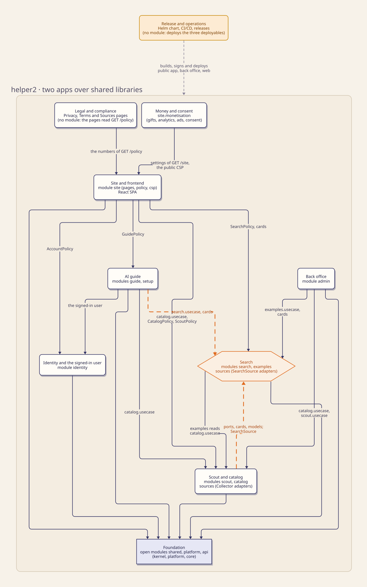

# Architecture

Helper2 is a modular monolith in two Spring Boot apps, the public app and the back office, over shared libraries
with Spring Modulith modules, hexagonal where business rules live. A React single-page app is served from its own
web image. PostgreSQL is the system of record and Redis a disposable cache. The decisions behind each part are in the [ADRs](adr/README.md), one per
feature, in the order a reader should learn them. Open work is in the
[backlog](https://github.com/silvioincalza/helper2.ai/issues): each ADR lists its open issues in its Backlog section.

## Software architecture

### Hexagonal: logic inside, adapters outside

The Kotlin domain (search, guide, scout) holds the rules and depends only on its ports, the Kotlin interfaces on its
edge. Java adapters implement those ports and talk to the outside: REST controllers on the driving side; sources,
Redis, PostgreSQL and the NVIDIA models on the driven side.

### The same system, one view at a time

| View | Shows |
|---|---|
| [Context](diagrams/architecture-context.svg) | The modules as boxes, who calls helper2, and what it calls. |
| [Context map](diagrams/context-map.svg) | The 10 bounded contexts of the backlog, the modules that hold each one, and the direction of each dependency. |
| [Hexagonal layers](diagrams/hexagonal-architecture.svg) | The domain inside, its ports on the edge, the adapters around it. |
| [One search](diagrams/architecture-search.svg) | The search ports and every source, cache and translator adapter behind them. |
| [One guide question](diagrams/architecture-guide.svg) | AskGuide, the search it reuses, the evidence gate and the LLM layer's guards. |
| [How the index grows](diagrams/architecture-index.svg) | Scout, its collectors, enrichment and its gap round (README, model card), and how the catalog stores and embeds. |
| [Set it up](diagrams/architecture-setup.svg) | The setup module on a resource page: run options from the registry and the README, the tool guide, its budgets and caches. |
| [Edge and shared services](diagrams/architecture-platform.svg) | Identity, rate limits, errors and the SPA, and the platform services every module uses, with their Redis keys and tables. |
| [Data model](diagrams/data-model.svg) | Every PostgreSQL table with its columns, keys and delete rules, grouped by area. |
| [Deployment](diagrams/infrastructure.svg) | The hosted helper2 on Kubernetes: hosts, namespaces, workloads, what each may reach, delivery, observability and backup. |

- Module boundaries are checked by `ModularityTest` (Spring Modulith + ArchUnit): [ADR 0002](adr/foundation/0002-modules-modular-monolith-hexagonal-where-the-rules-live.md).
- The API is contract-first: controller interfaces and frontend types are generated from `api/public.yaml`, `api/admin.yaml` and `api/common.yaml`;
  the shared part once, in the library `libs/web-contract`: [ADR 0003](adr/foundation/0003-contract-first-rest.md).

### Context map

An arrow from A to B says that A uses B. Every context uses Foundation: its modules (`shared`, `platform`, `api`)
are open. The other arrows are the module dependencies that pass `ApplicationModules.verify()`; a module is reached
only through its base package or a named interface (`search.usecase`, `catalog.usecase`, `scout.usecase`,
`examples.usecase`, the search cards). Three contexts have no module of their own: Money and consent lives in
`site.monetisation`, Legal and compliance is the text pages over `GET /policy`, and Release and operations is the
chart and the workflows that deploy the three deployables.

## Infrastructure

Staging and production (`helper2.ai`) run on one Kubernetes cluster, one Helm release per
namespace. The chart runs on any cluster ([ADR 0043](adr/operations/0043-runtime-topology-helm-chart-three-deployables.md), [deploy/k8s/README.md](../deploy/k8s/README.md)).

## Where to read next

| To understand | Read |
|---|---|
| One search, end to end | [0022 federated search](adr/search/0022-federated-search.md) → [0025 ranking](adr/search/0025-ranking.md) → [0023 language](adr/search/0023-catalog-full-text-index.md) → [0024 vector search](adr/search/0024-vector-search.md) |
| One guide question, end to end | [0008 LLM layer](adr/foundation/0008-llm-integration.md) → [0031 evidence gate and reason check](adr/guide/0031-guide-pipeline.md) → [0032 cost guard](adr/guide/0032-guide-cost-guard-and-answer-cache.md) |
| How the index grows | [0011 Scout runner](adr/scout/0011-scout-runner.md) → [0014 enrichment](adr/scout/0014-evidence-gated-enrichment.md) → [0012 collectors](adr/scout/0012-scout-collectors-and-events.md) → [0021 resource identity](adr/scout/0021-resource-identity-one-resource-per-repository.md) |
| Configuration and secrets | [0007](adr/foundation/0007-configuration-secrets-runtime-settings.md) |
| Logs, traces and meters (full meter list) | [0009 observability](adr/foundation/0009-observability.md) |
| From commit to prod | [0044 CI/CD](adr/operations/0044-ci-cd-and-supply-chain.md) → [0045 release](adr/operations/0045-releases-and-versions.md) |

All diagrams, with a flowchart and a sequence diagram per feature: [diagrams/](diagrams/README.md).
