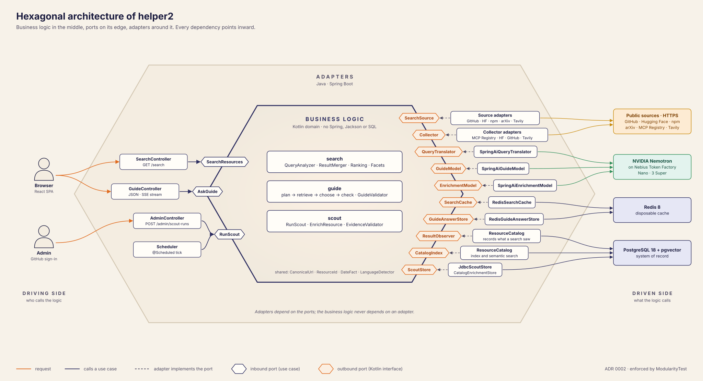
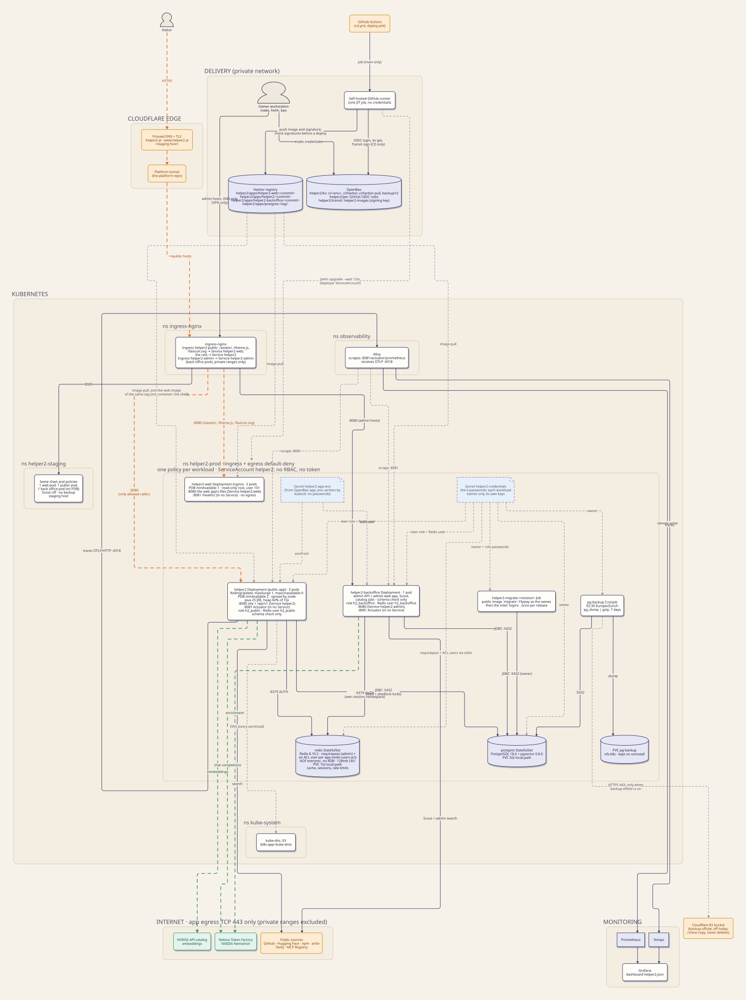

# Architecture

Helper2 is a modular monolith: one Spring Boot application with Spring Modulith modules, hexagonal where
business rules live, a React single-page app served by the same process, PostgreSQL as the system of record
and Redis as a disposable cache. The decisions behind each part are in the [ADRs](adr/README.md), one per
feature, in the order a reader should learn them. Open work is in the [roadmap](roadmap.md).

## Software architecture

### Hexagonal: logic inside, adapters outside

The Kotlin domain (search, guide, scout) holds the rules and depends only on its ports, the Kotlin interfaces on its
edge. Java adapters implement those ports and talk to the outside: REST controllers on the driving side; sources,
Redis, PostgreSQL and the NVIDIA models on the driven side.

### The same system, one view at a time

| View | Shows |
|---|---|
| [Context](diagrams/architecture-context.svg) | The modules as boxes, who calls helper2, and what it calls. |
| [One search](diagrams/architecture-search.svg) | The search ports and every source, cache and translator adapter behind them. |
| [One guide question](diagrams/architecture-guide.svg) | AskGuide, the search it reuses, the evidence gate and the LLM layer's guards. |
| [How the index grows](diagrams/architecture-index.svg) | Scout, its collectors, enrichment and its gap round (README, model card), and how the catalog stores and embeds. |
| [Set it up](diagrams/architecture-setup.svg) | The setup module on a resource page: run options from the registry and the README, the tool guide, its budgets and caches. |
| [Edge and shared services](diagrams/architecture-platform.svg) | Identity, rate limits, errors and the SPA, and the platform services every module uses, with their Redis keys and tables. |

- Module boundaries are checked by `ModularityTest` (Spring Modulith + ArchUnit): [ADR 0002](adr/foundation/0002-modular-monolith-libraries-and-apps.md).
- The API is contract-first: controller interfaces and frontend types are generated from `api/public.yaml`, `api/admin.yaml` and `api/common.yaml`:
  [ADR 0003](adr/foundation/0003-contract-first-rest-api.md).

## Infrastructure

Staging and production (`helper2.ai`) run on one Kubernetes cluster, one Helm release per
namespace. The chart runs on any cluster ([ADR 0032](adr/operations/0032-runtime-topology.md), [deploy/k8s/README.md](../deploy/k8s/README.md)).

## Where to read next

| To understand | Read |
|---|---|
| One search, end to end | [0009 federated search](adr/search/0009-federated-search.md) → [0012 ranking](adr/search/0012-ranking.md) → [0010 language](adr/search/0010-catalog-full-text-index.md) → [0011 vector search](adr/search/0011-vector-search-pgvector.md) |
| One guide question, end to end | [0008 LLM layer](adr/foundation/0008-llm-integration.md) → [0016 evidence gate](adr/guide/0016-guide-pipeline.md) → [0016 reason check](adr/guide/0016-guide-pipeline.md) → [0017 cost guard](adr/guide/0017-guide-cost-guard-and-answer-cache.md) |
| How the index grows | [0020 Scout runner](adr/scout/0020-scout-runner.md) → [0023 enrichment](adr/scout/0023-evidence-gated-enrichment.md) → [0021 collectors](adr/scout/0021-collectors-and-events.md) |
| Configuration and secrets | [0007](adr/foundation/0007-configuration-secrets-and-settings.md) |
| Logs, traces and meters (full meter list) | [0031 observability](adr/operations/0031-observability.md) |
| From commit to prod | [0033 CI/CD](adr/operations/0033-ci-cd-and-supply-chain.md) → [0034 release](adr/operations/0034-releases-and-versions.md) |

All diagrams, with a flowchart and a sequence diagram per feature: [diagrams/](diagrams/README.md).
