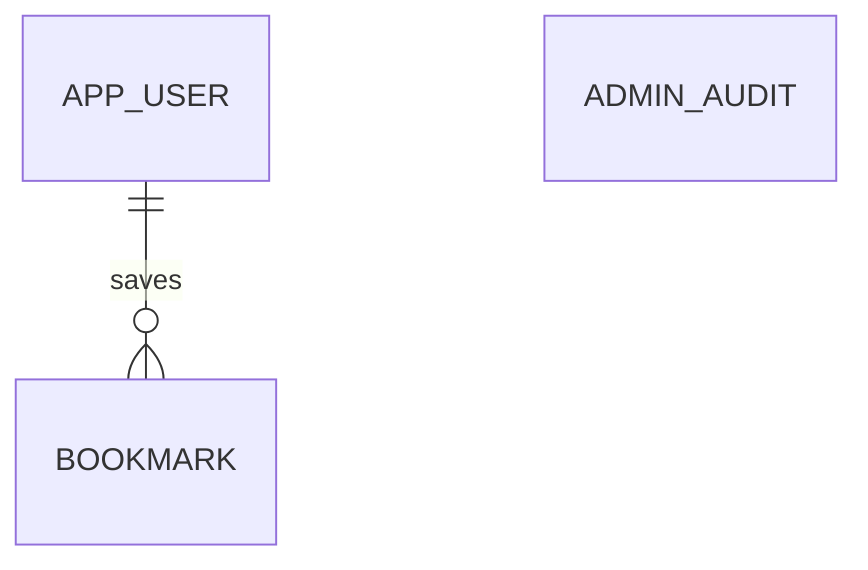

# Entity Model: Accounts

Optional sign-in with GitHub, saved resources, and the record of what administrators did.

## Entity Relationship Diagram

### APP_USER

A person who signed in with an identity provider; it keeps only what is needed to recognise the person and their preference.

| Attribute         | Description                                                                        | Data Type | Length/Precision | Validation Rules |
|-------------------|------------------------------------------------------------------------------------|-----------|------------------|------------------|
| id                | Unique identifier, created at the first sign-in                                    | String    | 36               | Primary Key      |
| provider          | Identity provider the person signed in with, such as `github`                      | String    | -                | Not Null         |
| subject           | The person's identifier at the identity provider                                   | String    | -                | Not Null         |
| display_name      | Name the identity provider gives, or the user name                                 | String    | -                | Optional         |
| last_signed_in_at | Time of the last sign-in; the current time when the account is created             | DateTime  | -                | Not Null         |
| radar_motion      | Whether the home page shows its motion (radar and moving lists); true by default   | Boolean   | -                | Not Null         |

#### Constraints

- A person has one account per identity provider (provider, subject are unique together).

### BOOKMARK

A resource a signed-in person saved, with its own copy of the title and the address so it stays on the list when the catalog changes.

| Attribute   | Description                                                                                     | Data Type | Length/Precision | Validation Rules                        |
|-------------|-------------------------------------------------------------------------------------------------|-----------|------------------|-----------------------------------------|
| user_id     | Account that saved the resource; deleting the account deletes its bookmarks                     | String    | 36               | Primary Key, Foreign Key (APP_USER.id)  |
| resource_id | Identifier of the saved resource; not checked against the catalog                               | String    | 36               | Primary Key                             |
| title       | Title of the resource when it was saved                                                         | String    | -                | Not Null                                |
| url         | Web address of the resource                                                                     | String    | -                | Not Null, Format: URL                   |
| type        | Resource type, when known                                                                       | String    | -                | Optional                                |
| saved_at    | When the resource was first saved; the current time by default                                  | DateTime  | -                | Not Null                                |

#### Constraints

- An account saves a resource at most once (user_id, resource_id are unique together).

### ADMIN_AUDIT

One action an administrator took in the back office, with its outcome; entries are only ever appended, and none younger than 729 days can be deleted.

| Attribute    | Description                                                     | Data Type | Length/Precision | Validation Rules |
|--------------|-----------------------------------------------------------------|-----------|------------------|------------------|
| id           | Unique identifier                                               | String    | 36               | Primary Key      |
| admin_id     | Administrator who took the action                               | String    | -                | Not Null         |
| action       | What the administrator did                                      | String    | -                | Not Null, Values: RESOLVE_REVIEW_ITEM, START_SCOUT_RUN, ADD_HOME_EXAMPLE, CHANGE_HOME_EXAMPLE, REMOVE_HOME_EXAMPLE, DRAFT_HOME_EXAMPLES, RECHECK_ENRICHMENT, REQUEUE_ENRICHMENT, SKIP_ENRICHMENT, PRIORITISE_ENRICHMENT, BACKFILL_CATEGORIES, CHANGE_SETTING, ADD_DISCOVERY_HOST, REMOVE_DISCOVERY_HOST, CHANGE_RELATIONSHIP_TARGET, ADD_RESOURCE, EDIT_CANDIDATE, SET_FIELD, DROP_FIELD, ADD_KNOWN_TARGET, EDIT_KNOWN_TARGET, REMOVE_KNOWN_TARGET, ADD_SHADOW_LIBRARY, REMOVE_SHADOW_LIBRARY, REMOVE_RESOURCE, ADD_LIST_SEED, REMOVE_LIST_SEED |
| target_id    | What the action was about, such as a setting key or a resource  | String    | -                | Optional         |
| at           | When the action was taken; the current time by default          | DateTime  | -                | Not Null         |
| outcome      | Result of the action, such as CHANGED, RESET or CONFLICT        | String    | -                | Not Null         |
| before_value | Value before the action; at most 100 characters                 | String    | -                | Optional         |
| after_value  | Value after the action; at most 100 characters                  | String    | -                | Optional         |
| reason       | Why the administrator acted; at most 500 characters             | String    | -                | Optional         |

#### Constraints

- An entry is never updated, and the table is never emptied at once.
- An entry is deleted only when it is older than 729 days.
