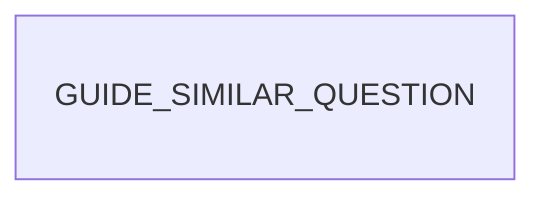

# Entity Model: AI Guide

Answers questions only from retrieved catalog results, with quotes checked by code, and writes setup guides from a tool's own documentation.

## Entity Relationship Diagram

### GUIDE_SIMILAR_QUESTION

The meaning of a question the guide answered, kept while its stored answer lives, so that a later question close in meaning and read the same way can reuse that answer.

| Attribute  | Description                                                                                                                         | Data Type | Length/Precision | Validation Rules |
|------------|-------------------------------------------------------------------------------------------------------------------------------------|-----------|------------------|------------------|
| answer_key | Key of the stored answer, 64 lower-case hexadecimal characters                                                                      | String    | -                | Primary Key      |
| group_key  | Digest of the model, build, guide settings, audience path and how the question was read; only questions of the same group are compared | String    | -                | Not Null         |
| embedding  | Embedding vector of 1024 numbers for the question                                                                                   | String    | -                | Not Null         |
| expires_at | When the stored answer expires; expired rows are deleted by a daily job                                                             | DateTime  | -                | Not Null         |
