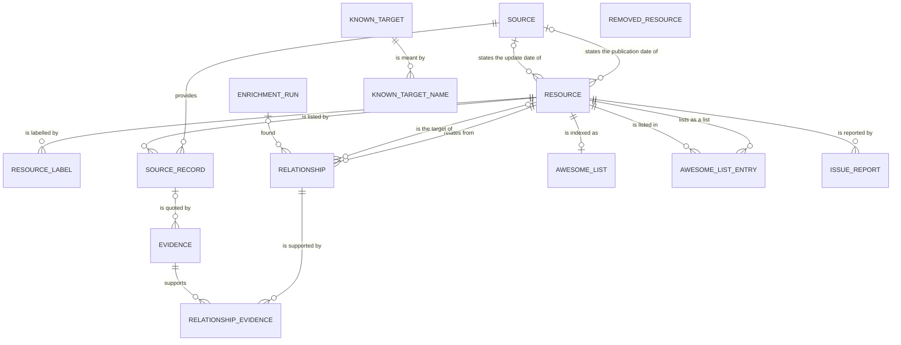

# Entity Model: Catalog

The stored AI resources, where each fact came from, and how they relate.

## Entity Relationship Diagram

From other modules: ENRICHMENT_RUN (Enrichment).

### SOURCE

A source helper2.ai reads (an external API, a feed, the curated list or the catalog itself), with how it is used and the outcome of its last call.

| Attribute       | Description                                                                      | Data Type | Length/Precision | Validation Rules                                              |
|-----------------|----------------------------------------------------------------------------------|-----------|------------------|---------------------------------------------------------------|
| id              | Short name of the source, 2 to 40 lower-case letters, digits or hyphens          | String    | -                | Primary Key                                                   |
| mode            | How the source is used: called live, indexed, curated by hand, or demonstration  | String    | -                | Not Null, Values: LIVE, INDEXED, CURATED, DEMO                |
| last_outcome    | Outcome of the last call to the source                                           | String    | -                | Optional, Values: SUCCEEDED, FAILED, TIMED_OUT, RATE_LIMITED, SKIPPED |
| last_checked_at | When the last outcome was recorded                                               | DateTime  | -                | Optional                                                      |

### RESOURCE

One AI resource in the catalog (a tool, model, MCP server, library, paper, news story, event, course, curated list and others), merged from every source record that lists it at one canonical address.

| Attribute                     | Description                                                                                                         | Data Type | Length/Precision | Validation Rules |
|-------------------------------|---------------------------------------------------------------------------------------------------------------------|-----------|------------------|------------------|
| id                            | Identifier derived from the canonical address (name-based UUID version 5)                                           | String    | 36               | Primary Key |
| canonical_url                 | Canonical address that identifies the resource                                                                      | String    | -                | Not Null, Unique, Format: URL |
| url                           | Address the resource is opened at                                                                                   | String    | -                | Not Null, Format: URL |
| title                         | Title, 1 to 300 characters                                                                                          | String    | -                | Not Null |
| description                   | Description, at most 4,000 characters                                                                               | String    | -                | Optional |
| description_origin            | Who wrote the description                                                                                           | String    | -                | Not Null, Values: SOURCE_PROVIDED, AI_EXTRACTED, AI_SUMMARY, CURATED, COMMUNITY, DEMO |
| language                      | Language of the title and description, an ISO 639-1 code or simple when not known; English by default              | String    | -                | Not Null, Values: simple, ar, hy, eu, ca, da, nl, en, fi, fr, de, el, hi, hu, id, ga, it, lt, no, pt, ro, ru, sr, es, sv, ta, tr |
| type                          | Kind of resource                                                                                                    | String    | -                | Not Null, Values: PRODUCT, MODEL, AGENT, PROMPT, SKILL, MCP_SERVER, LIBRARY, DATASET, ARTICLE, PAPER, NEWS, EVENT, COURSE, AWESOME_LIST, OTHER |
| audience                      | Whether the resource is for people who use AI, people who build with AI, both, or not known                        | String    | -                | Not Null, Values: USE_AI, BUILD_WITH_AI, BOTH, UNKNOWN |
| tech_level                    | Technical level the resource needs                                                                                  | String    | -                | Optional, Values: BEGINNER, INTERMEDIATE, ADVANCED |
| license                       | Licence as stated                                                                                                   | String    | -                | Optional |
| pricing                       | Pricing model                                                                                                       | String    | -                | Optional, Values: FREE, FREEMIUM, PAID, OPEN_SOURCE_SELF_HOSTED |
| open_source                   | Whether the resource is open source; empty when not known                                                           | Boolean   | -                | Optional |
| published_at                  | Publication date a source states                                                                                    | DateTime  | -                | Optional |
| published_precision           | Precision of the publication date; UNKNOWN when there is none                                                       | String    | -                | Not Null, Values: INSTANT, DAY, UNKNOWN |
| published_source_id           | Source that states the publication date                                                                             | String    | -                | Optional, Foreign Key (SOURCE.id) |
| updated_at                    | Last update date a source states                                                                                    | DateTime  | -                | Optional |
| updated_source_id             | Source that states the update date                                                                                  | String    | -                | Optional, Foreign Key (SOURCE.id) |
| event_starts_at               | Start of an event, as its source states it                                                                          | DateTime  | -                | Optional |
| event_ends_at                 | End of an event, as its source states it                                                                            | DateTime  | -                | Optional |
| first_discovered_at           | When helper2.ai first found the resource                                                                            | DateTime  | -                | Not Null |
| last_seen_at                  | When a source last returned the resource                                                                            | DateTime  | -                | Not Null |
| data_origin                   | How the resource came into the catalog: seen in a live search, indexed by the Scout, curated by a person, or demonstration | String | -             | Not Null, Values: OBSERVED, INDEXED, CURATED, DEMO |
| enrichment_status             | Outcome of the last AI enrichment; NOT_RUN by default                                                               | String    | -                | Not Null, Values: NOT_RUN, VALIDATED, PARTIAL, REJECTED, LLM_UNAVAILABLE |
| popularity                    | Popularity from 0 to 1, from the strongest signal its records state (stars, likes, downloads); 0 by default         | Decimal   | -                | Not Null |
| created_at                    | When the row was created                                                                                            | DateTime  | -                | Not Null |
| modified_at                   | When the row was last changed                                                                                       | DateTime  | -                | Not Null |
| package_terms                 | Words of its package names, registries, languages and a provider's other names, at most 2,000 characters            | String    | -                | Optional |
| search_vector                 | Full-text index generated from the title, the description and the package terms                                    | String    | -                | Optional |
| enrichment_rerun_requested_at | When an administrator asked for the enrichment to run again                                                        | DateTime  | -                | Optional |
| curated_fields                | List of the fields an administrator curated, each one of type, pricing, license, openSource, techLevel, audience, description, language, publishedAt; empty by default | String | - | Not Null |

#### Constraints

- A resource has a publication date exactly when its publication precision is not UNKNOWN.

### RESOURCE_LABEL

A tag, use case, platform or category attached to a resource.

| Attribute   | Description                                                  | Data Type | Length/Precision | Validation Rules                      |
|-------------|--------------------------------------------------------------|-----------|------------------|---------------------------------------|
| resource_id | Resource the label belongs to                                | String    | 36               | Primary Key, Foreign Key (RESOURCE.id) |
| kind        | Kind of label: TAG, USE_CASE, PLATFORM or CATEGORY           | String    | -                | Primary Key                           |
| value       | Text of the label, 1 to 60 characters                        | String    | -                | Primary Key                           |

#### Constraints

- A resource holds a label of one kind and value at most once (resource_id, kind, value are the key).

### SOURCE_RECORD

What one source states about one resource at its last retrieval: the raw facts the catalog merges and the provenance the resource page shows.

| Attribute              | Description                                                                       | Data Type | Length/Precision | Validation Rules                        |
|------------------------|-----------------------------------------------------------------------------------|-----------|------------------|-----------------------------------------|
| id                     | Unique identifier                                                                 | String    | 36               | Primary Key                             |
| source_id              | Source that states the record                                                     | String    | -                | Not Null, Foreign Key (SOURCE.id)       |
| external_id            | Identifier of the item at its source                                              | String    | -                | Not Null                                |
| resource_id            | Resource the record is merged into                                                | String    | 36               | Not Null, Foreign Key (RESOURCE.id)     |
| source_url             | Address of the item at its source                                                 | String    | -                | Not Null, Format: URL                   |
| canonical_url          | Canonical address of the item                                                     | String    | -                | Not Null, Format: URL                   |
| repository_url         | Code repository the item states, whether or not it joined it                      | String    | -                | Optional, Format: URL                   |
| title                  | Title as the source states it                                                     | String    | -                | Not Null                                |
| description            | Description as the source states it                                               | String    | -                | Optional                                |
| type                   | Kind of resource as the source states it                                          | String    | -                | Not Null                                |
| license                | Licence as the source states it                                                   | String    | -                | Optional                                |
| source_published_at    | Publication date the source states                                                | DateTime  | -                | Optional                                |
| source_updated_at      | Update date the source states                                                     | DateTime  | -                | Optional                                |
| source_event_starts_at | Event start the source states                                                     | DateTime  | -                | Optional                                |
| source_event_ends_at   | Event end the source states                                                       | DateTime  | -                | Optional                                |
| retrieved_at           | When the source was read                                                          | DateTime  | -                | Not Null                                |
| fingerprint            | Fingerprint of the stated content, to see whether it changed                      | String    | -                | Not Null                                |
| extra                  | JSON object of further facts the source states, such as popularity counts, vitality and package details; empty by default | String | - | Not Null                         |
| created_at             | When the record was first stored                                                  | DateTime  | -                | Not Null                                |

#### Constraints

- A source states one record per item (source_id, external_id are unique together).

### EVIDENCE

A quote with the address and the retrieval time of the page it comes from, which supports a fact, a relationship or a summary claim.

| Attribute        | Description                                                    | Data Type | Length/Precision | Validation Rules                         |
|------------------|----------------------------------------------------------------|-----------|------------------|------------------------------------------|
| id               | Unique identifier                                              | String    | 36               | Primary Key                              |
| source_record_id | Source record the quote was read from                          | String    | 36               | Optional, Foreign Key (SOURCE_RECORD.id) |
| source_url       | Address of the page the quote comes from                       | String    | -                | Not Null, Format: URL                    |
| retrieved_at     | When the page was read                                         | DateTime  | -                | Not Null                                 |
| excerpt          | The quoted text, at most 500 characters                        | String    | -                | Optional                                 |
| created_at       | When the evidence was stored                                   | DateTime  | -                | Not Null                                 |

### RELATIONSHIP

A statement that one resource integrates with, uses, supports, is compatible with or is about another resource, a known vendor, a service or a tool.

| Attribute          | Description                                                                                       | Data Type | Length/Precision | Validation Rules                                             |
|--------------------|---------------------------------------------------------------------------------------------------|-----------|------------------|--------------------------------------------------------------|
| id                 | Unique identifier                                                                                 | String    | 36               | Primary Key                                                  |
| from_resource_id   | Resource the relationship starts from                                                             | String    | 36               | Not Null, Foreign Key (RESOURCE.id)                          |
| to_resource_id     | Catalog resource the relationship points at; empty for a known target or an unresolved name       | String    | 36               | Optional, Foreign Key (RESOURCE.id)                          |
| to_title           | Name of the target as stated                                                                      | String    | -                | Not Null                                                     |
| kind               | Kind of relationship                                                                              | String    | -                | Not Null, Values: INTEGRATES_WITH, USES, SUPPORTS, COMPATIBLE_WITH, ABOUT |
| verification       | How far the evidence confirms it                                                                  | String    | -                | Not Null, Values: VERIFIED, UNVERIFIED, CONFLICTING, REJECTED |
| origin             | Who stated it: a model reading a record, or only the vendor's own pages                           | String    | -                | Not Null, Values: AI_EXTRACTED, SELF_DECLARED                |
| enrichment_run_id  | AI enrichment that found it                                                                       | String    | 36               | Optional, Foreign Key (ENRICHMENT_RUN.id)                    |
| created_at         | When it was stored                                                                                | DateTime  | -                | Not Null                                                     |
| target_origin      | Set when an administrator chose the target                                                        | String    | -                | Optional, Values: CURATED                                    |
| target_kind        | Kind of known target the relationship names, when it names one                                    | String    | -                | Optional, Values: VENDOR, SERVICE, TOOL                      |
| stated_target_kind | Kind of target the model stated from the name                                                     | String    | -                | Optional, Values: PRODUCT, VENDOR, SERVICE                   |

#### Constraints

- A relationship that names a known target points at no catalog resource (target_kind set means to_resource_id is empty).
- A resource has one relationship of a kind to a target name (from_resource_id, kind, to_title are unique together).

### RELATIONSHIP_EVIDENCE

Links a relationship to the evidence that supports it.

| Attribute       | Description                   | Data Type | Length/Precision | Validation Rules                           |
|-----------------|-------------------------------|-----------|------------------|--------------------------------------------|
| relationship_id | Relationship that is supported | String   | 36               | Primary Key, Foreign Key (RELATIONSHIP.id) |
| evidence_id     | Evidence that supports it     | String    | 36               | Primary Key, Foreign Key (EVIDENCE.id)     |

#### Constraints

- A piece of evidence supports a relationship at most once (relationship_id, evidence_id are the key).

### AWESOME_LIST

The full-text index of a curated list ("awesome list") that is itself a resource, refreshed each time the list is read.

| Attribute     | Description                                          | Data Type | Length/Precision | Validation Rules                       |
|---------------|------------------------------------------------------|-----------|------------------|----------------------------------------|
| list_id       | Resource that is the list                            | String    | 36               | Primary Key, Foreign Key (RESOURCE.id) |
| search_vector | Full-text index of the list's own words              | String    | -                | Not Null                               |
| updated_at    | When the list was last read                          | DateTime  | -                | Not Null                               |
| directory     | Whether the list is a page of a directory host; false by default | Boolean | -      | Not Null                               |

### AWESOME_LIST_ENTRY

One resource a curated list names, with the headings above its entry and the words of the entry.

| Attribute     | Description                                                                    | Data Type | Length/Precision | Validation Rules                       |
|---------------|--------------------------------------------------------------------------------|-----------|------------------|----------------------------------------|
| list_id       | Resource that is the list                                                      | String    | 36               | Primary Key, Foreign Key (RESOURCE.id) |
| resource_id   | Resource the entry names                                                       | String    | 36               | Primary Key, Foreign Key (RESOURCE.id) |
| heading_path  | Headings above the entry, such as "Tools > Vector databases", at most 200 characters | String | -           | Not Null                               |
| search_vector | Full-text index of the entry's words                                           | String    | -                | Not Null                               |
| updated_at    | When the entry was last read                                                   | DateTime  | -                | Not Null                               |

#### Constraints

- A list names a resource at most once (list_id, resource_id are the key).
- A list never names itself (list_id differs from resource_id).

### KNOWN_TARGET

A vendor, service or tool that a relationship may name without a catalog resource.

| Attribute | Description                                                              | Data Type | Length/Precision | Validation Rules                    |
|-----------|--------------------------------------------------------------------------|-----------|------------------|-------------------------------------|
| id        | Unique identifier                                                        | String    | 36               | Primary Key                         |
| kind      | Kind of target                                                           | String    | -                | Not Null, Values: VENDOR, SERVICE, TOOL |
| name      | Name as shown, 2 to 60 characters                                        | String    | -                | Not Null                            |
| added_by  | Who added it: an administrator, or the migration for the first list      | String    | -                | Not Null                            |
| added_at  | When it was added                                                        | DateTime  | -                | Not Null                            |
| origin    | Typed by a person, or accepted from a Scout proposal; CURATED by default | String    | -                | Not Null, Values: CURATED, DISCOVERED |

### KNOWN_TARGET_NAME

One name that means a known target, the shown name included, stored with its comparison key.

| Attribute | Description                                                                                       | Data Type | Length/Precision | Validation Rules                        |
|-----------|---------------------------------------------------------------------------------------------------|-----------|------------------|-----------------------------------------|
| name_key  | Comparison key: lower case, repeated spaces as one, final "'s" removed; 2 to 60 characters        | String    | -                | Primary Key                             |
| target_id | Known target the name means                                                                       | String    | 36               | Not Null, Foreign Key (KNOWN_TARGET.id) |
| name      | The name as written, 2 to 60 characters                                                           | String    | -                | Not Null                                |

### ISSUE_REPORT

A visitor's report that a resource holds wrong, outdated or broken information.

| Attribute   | Description                                         | Data Type | Length/Precision | Validation Rules                                  |
|-------------|-----------------------------------------------------|-----------|------------------|---------------------------------------------------|
| id          | Unique identifier                                   | String    | 36               | Primary Key                                       |
| resource_id | Resource the report is about                        | String    | 36               | Not Null, Foreign Key (RESOURCE.id)               |
| kind        | Kind of problem                                     | String    | -                | Not Null, Values: WRONG, OUTDATED, BROKEN_LINK, OTHER |
| field       | Field the report is about                           | String    | -                | Optional                                          |
| message     | What is wrong, 5 to 2,000 characters                | String    | -                | Not Null                                          |
| created_at  | When the report was made                            | DateTime  | -                | Not Null                                          |

### REMOVED_RESOURCE

The identifier of a resource an administrator removed, kept so that no source adds it back to the catalog until a person adds it again.

| Attribute    | Description                                                                  | Data Type | Length/Precision | Validation Rules |
|--------------|------------------------------------------------------------------------------|-----------|------------------|------------------|
| resource_key | Identifier the removed resource had; it points at no row, since the resource is deleted | String | 36    | Primary Key      |
| removed_at   | When it was removed                                                          | DateTime  | -                | Not Null         |
