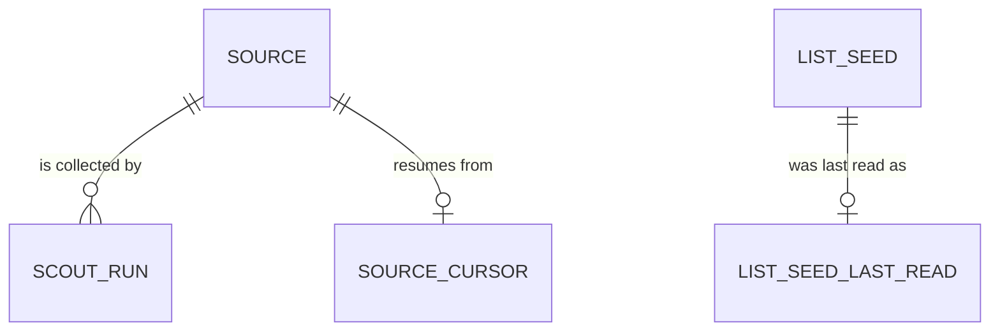

# Entity Model: Discovery

Collects new AI resources from the sources on a schedule and admits them as candidates.

## Entity Relationship Diagram

From other modules: SOURCE (Catalog).

### SCOUT_RUN

One pass of one collector over its source, started by the daily schedule or by an administrator, with its outcome and counts.

| Attribute          | Description                                                                                     | Data Type | Length/Precision | Validation Rules                                  |
|--------------------|-------------------------------------------------------------------------------------------------|-----------|------------------|---------------------------------------------------|
| id                 | Unique identifier of the run, given by the system when the run starts                           | String    | 36               | Primary Key                                       |
| source_id          | Source the collector reads                                                                      | String    | -                | Not Null, Foreign Key (SOURCE.id)                 |
| status             | State of the run; a run left running by a stopped instance is closed as failed at startup       | String    | -                | Not Null, Values: RUNNING, SUCCEEDED, FAILED, SKIPPED |
| started_at         | When the run started                                                                            | DateTime  | -                | Not Null                                          |
| finished_at        | When the run ended; empty while it runs                                                         | DateTime  | -                | Optional                                          |
| items_seen         | Number of items the collector read; 0 by default                                                | Integer   | 10               | Not Null                                          |
| items_changed      | Number of catalog resources the run added or changed; 0 by default                              | Integer   | 10               | Not Null                                          |
| enrichments_queued | Number of enrichments of changed resources that the run kept; 0 by default                      | Integer   | 10               | Not Null                                          |
| message            | Note on the run: why it was skipped or failed, or what it left for the next run                 | String    | -                | Optional                                          |

### SCOUT_SCHEDULE

The single record of when the last scheduled run of the Scout ended, shared by every instance to decide whether the next daily run is due.

| Attribute     | Description                                                       | Data Type | Length/Precision | Validation Rules |
|---------------|-------------------------------------------------------------------|-----------|------------------|------------------|
| id            | Key of the single row; always true                                | Boolean   | -                | Primary Key      |
| last_ended_at | When the last scheduled run ended                                 | DateTime  | -                | Not Null         |

#### Constraints

- The key must be true, so the table holds at most one row.

### SOURCE_CURSOR

The position where a collector resumes its pass over a source in the next run.

| Attribute  | Description                                                                                                                                  | Data Type | Length/Precision | Validation Rules                              |
|------------|----------------------------------------------------------------------------------------------------------------------------------------------|-----------|------------------|-----------------------------------------------|
| source_id  | Source whose position this is                                                                                                                | String    | -                | Primary Key, Foreign Key (SOURCE.id)          |
| cursor     | JSON object with the checkpoint of the last finished pass, the resume position inside an open pass (or the mark that candidates were held back), and when the open pass started | String    | -                | Not Null                                      |
| updated_at | When the position was last saved; set by the database on insert                                                                              | DateTime  | -                | Not Null                                      |

### DISCOVERY_HOST

A host that an administrator names for discovery as a writing site, whose posts become article candidates, or as a directory, whose pages are never kept and whose list pages are read as lists only when an administrator turns that on.

| Attribute | Description                                                                    | Data Type | Length/Precision | Validation Rules                  |
|-----------|--------------------------------------------------------------------------------|-----------|------------------|-----------------------------------|
| host      | Host name in lower case, without "www." and a trailing dot; 3 to 253 characters | String    | -                | Primary Key                       |
| kind      | List the host belongs to                                                       | String    | -                | Not Null, Values: WRITING, DIRECTORY |
| added_by  | Administrator who added the host                                               | String    | -                | Not Null                          |
| added_at  | When the host was added                                                        | DateTime  | -                | Not Null                          |
| reason    | Why the host was added; at most 500 characters                                 | String    | -                | Optional                          |
| reads_lists | Whether the list pages of the host are read as lists; false by default       | Boolean   | -                | Not Null                          |

#### Constraints

- reads_lists is true only for a directory host.

### LIST_SEED

A curated list, a GitHub repository or a web page, that the Scout reads on every pass of the awesome-list collector. An administrator added it, or discovery found the page on a directory host whose lists are read.

| Attribute     | Description                                                                                                  | Data Type | Length/Precision | Validation Rules                               |
|---------------|--------------------------------------------------------------------------------------------------------------|-----------|------------------|------------------------------------------------|
| address       | The repository as "owner/name" in lower case, or the https address of the web page (at most 300 characters)  | String    | -                | Primary Key                                    |
| kind          | Whether the list is a GitHub repository or a web page                                                        | String    | -                | Not Null, Values: GITHUB_REPOSITORY, WEB_PAGE  |
| origin        | Who added the list                                                                                           | String    | -                | Not Null, Values: ADMINISTRATOR, DISCOVERY     |
| added_by      | Administrator who added the list, or the discovery collector that found it                                   | String    | -                | Not Null                                       |
| added_at      | When the list was added                                                                                      | DateTime  | -                | Not Null                                       |
| reason        | Why the list was added; at most 500 characters                                                               | String    | -                | Optional                                       |
| read_tried_at | When the last read of a web page started; empty for a GitHub repository                                      | DateTime  | -                | Optional                                       |
| read_failures | Failed reads of a web page in a row since its last successful read; 0 by default                             | Integer   | 10               | Not Null, Min: 0                               |

#### Constraints

- A GitHub repository address matches "owner/name" (owner of 1 to 39 lower-case letters, digits or hyphens, name of 1 to 100 lower-case letters, digits, dots, underscores or hyphens); a web page address is an https address with a host name and no fragment, of at most 300 characters.
- read_tried_at is set only for a web page.
- A list discovery added is a web page.

### LIST_SEED_LAST_READ

The text of the last successful read of an added web page, used while the page is not due to be read again or is no longer read.

| Attribute    | Description                                                                 | Data Type | Length/Precision | Validation Rules                         |
|--------------|-----------------------------------------------------------------------------|-----------|------------------|------------------------------------------|
| address      | Added list this read belongs to; removed with the list                      | String    | -                | Primary Key, Foreign Key (LIST_SEED.address) |
| read_at      | When the page was read                                                      | DateTime  | -                | Not Null                                 |
| headings     | JSON list of the page's headings                                            | String    | -                | Not Null                                 |
| entries      | JSON list of the list entries that point to GitHub repositories, with their section and text | String    | -                | Not Null                                 |
| links        | JSON list of the other links of the list, with their words and section      | String    | -                | Not Null                                 |
| text_lines   | Number of text lines on the page                                            | Integer   | 10               | Not Null, Min: 0                         |
| linked_items | Number of list items on the page that carry a link                          | Integer   | 10               | Not Null, Min: 0                         |
