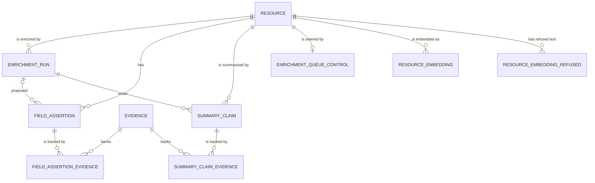

# Entity Model: Enrichment

Adds descriptions, fields and embeddings to resources, each fact backed by a checked quote.

## Entity Relationship Diagram

From other modules: RESOURCE (Catalog), EVIDENCE (Catalog).

### ENRICHMENT_RUN

One attempt to enrich a resource with the language model, with the model, the prompt version, the outcome and the validation issues.

| Attribute         | Description                                                                                         | Data Type | Length/Precision | Validation Rules                                                    |
|-------------------|-----------------------------------------------------------------------------------------------------|-----------|------------------|---------------------------------------------------------------------|
| id                | Unique identifier of the run, given by the system                                                   | String    | 36               | Primary Key                                                         |
| resource_id       | Resource the run enriched; removed with the resource                                                | String    | 36               | Not Null, Foreign Key (RESOURCE.id)                                 |
| provider          | Provider of the language model                                                                      | String    | -                | Not Null                                                            |
| model             | Identifier of the language model                                                                    | String    | -                | Not Null                                                            |
| prompt_version    | Version of the enrichment prompt: a short hexadecimal digest of the rendered system prompt          | String    | -                | Not Null                                                            |
| input_fingerprint | Digest of the source text, the fixed epoch and the model, used to skip unchanged input; 32 hexadecimal characters | String    | -                | Not Null                                                            |
| started_at        | When the run started                                                                                | DateTime  | -                | Not Null                                                            |
| finished_at       | When the run was recorded                                                                           | DateTime  | -                | Optional                                                            |
| outcome           | Result of the run                                                                                   | String    | -                | Not Null, Values: VALIDATED, PARTIAL, REJECTED, LLM_UNAVAILABLE, FAILED |
| validation_errors | JSON list of the validation issues of the answer, or of the failure reason; empty list by default   | String    | -                | Not Null                                                            |
| extra_evidence    | The added texts the kept answer used, such as the read-me or the official pages; at most 300 characters | String    | -                | Optional                                                            |

### FIELD_ASSERTION

A value of one field of a resource, such as its pricing, licence or audience, with where the value comes from and how far it is verified; an administrator's curated values are kept here too.

| Attribute         | Description                                                                                   | Data Type | Length/Precision | Validation Rules                                                    |
|-------------------|-----------------------------------------------------------------------------------------------|-----------|------------------|---------------------------------------------------------------------|
| id                | Unique identifier of the value, given by the system                                           | String    | 36               | Primary Key                                                         |
| resource_id       | Resource the value describes; removed with the resource                                       | String    | 36               | Not Null, Foreign Key (RESOURCE.id)                                 |
| field             | Name of the field, such as audience, techLevel, pricing, openSource, license, useCase, platforms or type | String    | -                | Not Null                                                            |
| value             | The value of the field                                                                        | String    | -                | Not Null                                                            |
| origin            | Who states the value: extracted by the model from a quote, estimated by the model, stated by the vendor's own pages, or curated by an administrator | String    | -                | Not Null, Values: AI_EXTRACTED, AI_ESTIMATED, SELF_DECLARED, CURATED |
| verification      | How far the value is checked against its quotes and the source facts                          | String    | -                | Not Null, Values: VERIFIED, UNVERIFIED, CONFLICTING, REJECTED       |
| enrichment_run_id | Enrichment run that proposed the value; empty for a curated value                             | String    | 36               | Optional, Foreign Key (ENRICHMENT_RUN.id)                           |
| created_at        | When the value was stored; set by the database on insert                                      | DateTime  | -                | Not Null                                                            |

### FIELD_ASSERTION_EVIDENCE

The link between a field value and a piece of evidence whose quote states it.

| Attribute    | Description                                                    | Data Type | Length/Precision | Validation Rules                                  |
|--------------|----------------------------------------------------------------|-----------|------------------|---------------------------------------------------|
| assertion_id | Field value the evidence backs; removed with the value         | String    | 36               | Primary Key, Foreign Key (FIELD_ASSERTION.id)     |
| evidence_id  | Evidence that holds the quote; removed with the evidence       | String    | 36               | Primary Key, Foreign Key (EVIDENCE.id)            |

#### Constraints

- The key is the pair of field value and evidence.

### SUMMARY_CLAIM

One sentence of a resource's AI-written summary, in its place, written by one enrichment run.

| Attribute         | Description                                                                      | Data Type | Length/Precision | Validation Rules                        |
|-------------------|----------------------------------------------------------------------------------|-----------|------------------|-----------------------------------------|
| id                | Unique identifier of the sentence, given by the system                           | String    | 36               | Primary Key                             |
| resource_id       | Resource the sentence describes; removed with the resource                       | String    | 36               | Not Null, Foreign Key (RESOURCE.id)     |
| enrichment_run_id | Enrichment run that wrote the sentence                                           | String    | 36               | Not Null, Foreign Key (ENRICHMENT_RUN.id) |
| position          | Place of the sentence in the summary, from 0                                     | Integer   | 10               | Not Null                                |
| text              | The sentence; at most 400 characters                                             | String    | -                | Not Null                                |
| self_declared     | Whether the sentence rests on the vendor's own pages; false by default           | Boolean   | -                | Not Null                                |

#### Constraints

- The pair of enrichment run and position is unique.

### SUMMARY_CLAIM_EVIDENCE

The link between a summary sentence and a piece of evidence whose quote states it.

| Attribute   | Description                                                    | Data Type | Length/Precision | Validation Rules                               |
|-------------|----------------------------------------------------------------|-----------|------------------|------------------------------------------------|
| claim_id    | Summary sentence the evidence backs; removed with the sentence | String    | 36               | Primary Key, Foreign Key (SUMMARY_CLAIM.id)    |
| evidence_id | Evidence that holds the quote; removed with the evidence       | String    | 36               | Primary Key, Foreign Key (EVIDENCE.id)         |

#### Constraints

- The key is the pair of summary sentence and evidence.

### ENRICHMENT_QUEUE_CONTROL

An administrator's choice for one resource in the enrichment queue: moved to the top, skipped, or put back with its failed runs counted again from zero.

| Attribute         | Description                                                                                   | Data Type | Length/Precision | Validation Rules                      |
|-------------------|-----------------------------------------------------------------------------------------------|-----------|------------------|---------------------------------------|
| resource_id       | Resource the choice is about; removed with the resource                                       | String    | 36               | Primary Key, Foreign Key (RESOURCE.id) |
| prioritised_at    | When the resource was moved to the top; it stays there until its next enrichment run          | DateTime  | -                | Optional                              |
| skipped_at        | When the resource was skipped                                                                 | DateTime  | -                | Optional                              |
| skip_reason       | Why the resource was skipped; at most 200 characters                                          | String    | -                | Optional                              |
| failures_reset_at | From when failed runs count again after the resource was put back                             | DateTime  | -                | Optional                              |
| updated_at        | When the choice last changed; set by the database on insert                                   | DateTime  | -                | Not Null                              |

#### Constraints

- A resource is not moved to the top and skipped at the same time.
- A skip reason is stored only with a skip time.

### RESOURCE_EMBEDDING

The vector of a resource's title and description for one embedding model, used by semantic search.

| Attribute   | Description                                                                          | Data Type | Length/Precision | Validation Rules                       |
|-------------|--------------------------------------------------------------------------------------|-----------|------------------|----------------------------------------|
| resource_id | Resource the vector represents; removed with the resource                            | String    | 36               | Primary Key, Foreign Key (RESOURCE.id) |
| model       | Embedding model that made the vector                                                 | String    | -                | Primary Key                            |
| text_hash   | Digest of the embedded title and description, 32 hexadecimal characters; a different digest means the text changed | String    | -                | Not Null                               |
| embedding   | Embedding vector of 1024 numbers                                                     | String    | -                | Not Null                               |
| embedded_at | When the vector was stored; set by the database on insert                            | DateTime  | -                | Not Null                               |

#### Constraints

- The key is the pair of resource and model.

### RESOURCE_EMBEDDING_REFUSED

A resource text that the embedding service refused for one model, left out of indexing until the text changes.

| Attribute   | Description                                                                          | Data Type | Length/Precision | Validation Rules                       |
|-------------|--------------------------------------------------------------------------------------|-----------|------------------|----------------------------------------|
| resource_id | Resource whose text was refused; removed with the resource                           | String    | 36               | Primary Key, Foreign Key (RESOURCE.id) |
| model       | Embedding model that refused the text                                                | String    | -                | Primary Key                            |
| text_hash   | Digest of the refused title and description, 32 hexadecimal characters                | String    | -                | Not Null                               |
| refused_at  | When the text was refused; set by the database on insert                             | DateTime  | -                | Not Null                               |

#### Constraints

- The key is the pair of resource and model.
