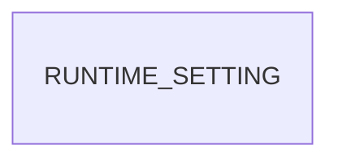

# Entity Model: Operations

The settings the back office may change at runtime and the daily removal of data past its retention period.

## Entity Relationship Diagram

### RUNTIME_SETTING

One change of a runtime limit or switch made by an administrator; the newest change of a setting holds its value, and changes are appended, never edited.

| Attribute  | Description                                                                                                  | Data Type | Length/Precision | Validation Rules      |
|------------|--------------------------------------------------------------------------------------------------------------|-----------|------------------|-----------------------|
| version    | Version of the change, rising across all settings                                                            | Long      | 19               | Primary Key, Sequence |
| name       | Key of the setting, such as `guide.dailyModelCalls`; 1 to 100 characters                                     | String    | -                | Not Null              |
| value      | New value: zero or more, 1 or 0 for a switch; empty when the change resets the setting to its default        | Long      | 19               | Optional              |
| changed_by | Administrator who made the change                                                                            | String    | -                | Not Null              |
| changed_at | When the change was made                                                                                     | DateTime  | -                | Not Null              |
| reason     | Why the administrator made the change; at most 500 characters                                                | String    | -                | Optional              |

#### Constraints

- A change is never updated after it is stored.
- The value, when present, is zero or more.
