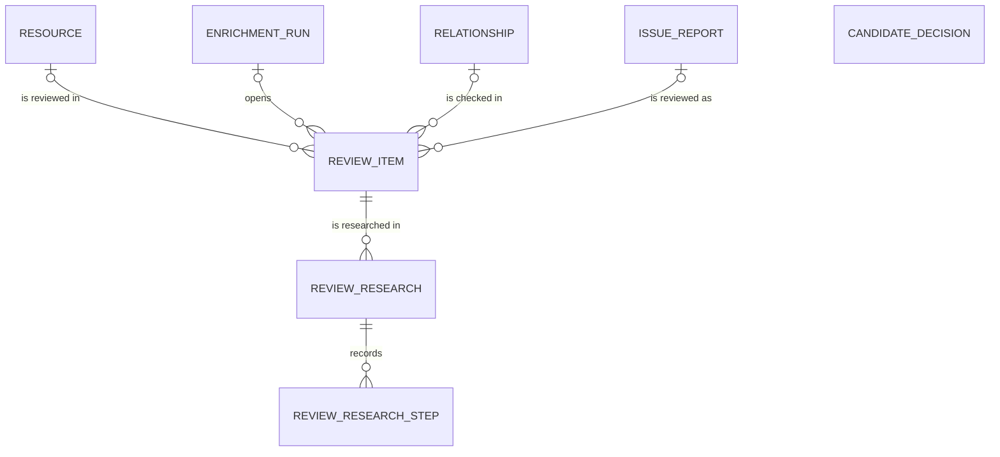

# Entity Model: Review

A person decides what the machine could not: new candidates, reported errors, relationships and field values.

## Entity Relationship Diagram

From other modules: RESOURCE (Catalog), ENRICHMENT_RUN (Enrichment), RELATIONSHIP (Catalog), ISSUE_REPORT (Catalog)

### REVIEW_ITEM

A question a person must answer: an enrichment check, an unverified relationship, a user report, or a resource, course, example or known target candidate.

| Attribute         | Description                                                                                                                                  | Data Type | Length/Precision | Validation Rules                                                                                                                    |
|-------------------|----------------------------------------------------------------------------------------------------------------------------------------------|-----------|------------------|-------------------------------------------------------------------------------------------------------------------------------------|
| id                | Unique identifier                                                                                                                            | String    | 36               | Primary Key                                                                                                                         |
| kind              | What the item asks about                                                                                                                     | String    | -                | Not Null, Values: ENRICHMENT_VALIDATION, RELATIONSHIP_CANDIDATE, USER_REPORT, COURSE_CANDIDATE, EXAMPLE_CANDIDATE, RESOURCE_CANDIDATE, KNOWN_TARGET_CANDIDATE |
| status            | Where the decision stands; OPEN by default, SUPERSEDED set by a newer enrichment run or a decision by target name, never by accept or reject | String    | -                | Not Null, Values: OPEN, ACCEPTED, REJECTED, SUPERSEDED                                                                              |
| resource_id       | Resource the item is about; empty for a candidate not yet in the catalog; deleting the resource deletes the item                            | String    | 36               | Optional, Foreign Key (RESOURCE.id)                                                                                                 |
| enrichment_run_id | Enrichment run that opened the item                                                                                                          | String    | 36               | Optional, Foreign Key (ENRICHMENT_RUN.id)                                                                                           |
| relationship_id   | Relationship a relationship candidate asks about; emptied when the relationship is deleted                                                   | String    | 36               | Optional, Foreign Key (RELATIONSHIP.id)                                                                                             |
| report_id         | User report the item reviews; deleting the report deletes the item                                                                           | String    | 36               | Optional, Foreign Key (ISSUE_REPORT.id)                                                                                             |
| candidate_url     | Canonical address of a candidate page                                                                                                        | String    | -                | Optional, Format: URL                                                                                                               |
| reason            | One line that says why the item is open                                                                                                      | String    | -                | Not Null                                                                                                                            |
| details           | JSON object with the structured candidate, the known target proposal or the drafted example                                                 | String    | -                | Optional                                                                                                                            |
| note              | Plain text details of the other kinds: validation errors, why a relationship is not verified, the note of a report                          | String    | -                | Optional                                                                                                                            |
| created_at        | When the item was opened                                                                                                                     | DateTime  | -                | Not Null                                                                                                                            |
| resolved_at       | When the item was decided or superseded                                                                                                      | DateTime  | -                | Optional                                                                                                                            |
| resolved_by       | Administrator who decided the item                                                                                                           | String    | -                | Optional                                                                                                                            |
| resolution_note   | Note of the decision, or why the item was superseded                                                                                         | String    | -                | Optional                                                                                                                            |

#### Constraints

- resolved_at is set exactly when the status is not OPEN.
- details is set only for RESOURCE_CANDIDATE, COURSE_CANDIDATE, EXAMPLE_CANDIDATE and KNOWN_TARGET_CANDIDATE.
- note is never set for RESOURCE_CANDIDATE, EXAMPLE_CANDIDATE and KNOWN_TARGET_CANDIDATE.
- There is at most one item for each kind and candidate address (kind, candidate_url are unique together when candidate_url is set).
- There is at most one KNOWN_TARGET_CANDIDATE for each name key held in details.

### CANDIDATE_DECISION

The decision a person made on a candidate, kept by its address or name key so the same candidate is never proposed again, even after its review item is deleted.

| Attribute     | Description                                                                                                        | Data Type | Length/Precision | Validation Rules                      |
|---------------|--------------------------------------------------------------------------------------------------------------------|-----------|------------------|---------------------------------------|
| kind          | Kind of candidate: RESOURCE_CANDIDATE, EXAMPLE_CANDIDATE, COURSE_CANDIDATE or KNOWN_TARGET_CANDIDATE                | String    | -                | Primary Key                           |
| candidate_key | Key made from the candidate's address, or from the name key of a known target proposal                            | String    | 36               | Primary Key                           |
| status        | The decision                                                                                                       | String    | -                | Not Null, Values: ACCEPTED, REJECTED, SUPERSEDED |
| decided_at    | When the decision was made                                                                                         | DateTime  | -                | Not Null                              |

#### Constraints

- kind and candidate_key form the key: one decision per kind and candidate.

### REVIEW_RESEARCH

One run of the research agent on a resource or course candidate, with its status and its checked result.

| Attribute         | Description                                                                              | Data Type | Length/Precision | Validation Rules                                       |
|-------------------|------------------------------------------------------------------------------------------|-----------|------------------|--------------------------------------------------------|
| id                | Unique identifier                                                                        | String    | 36               | Primary Key, Sequence                                  |
| review_item_id    | Review item researched; deleting the item deletes its runs                               | String    | 36               | Not Null, Foreign Key (REVIEW_ITEM.id)                 |
| status            | State of the run                                                                         | String    | -                | Not Null, Values: QUEUED, RUNNING, DONE, FAILED, CANCELLED |
| model             | Model the run uses, 1 to 200 characters                                                  | String    | -                | Not Null                                               |
| requested_by      | Administrator who started the run                                                        | String    | -                | Not Null                                               |
| requested_at      | When the run was queued                                                                  | DateTime  | -                | Not Null                                               |
| started_at        | When a worker started the run                                                            | DateTime  | -                | Optional                                               |
| finished_at       | When the run ended                                                                       | DateTime  | -                | Optional                                               |
| heartbeat_at      | When the run last stored a step                                                          | DateTime  | -                | Optional                                               |
| steps             | Number of steps stored, 0 to begin with                                                  | Integer   | 10               | Not Null                                               |
| prompt_tokens     | Tokens sent to the model, 0 to begin with                                                | Integer   | 10               | Not Null                                               |
| completion_tokens | Tokens the model wrote, 0 to begin with                                                  | Integer   | 10               | Not Null                                               |
| result            | JSON object with the verdict and each attribute's values, status and quotes              | String    | -                | Optional                                               |
| error             | Why the run failed, at most 2,000 characters                                             | String    | -                | Optional                                               |

#### Constraints

- result is set exactly when the status is DONE.
- finished_at is set exactly when the status is DONE, FAILED or CANCELLED.
- A review item has at most one run that is QUEUED or RUNNING.

### REVIEW_RESEARCH_STEP

One stored step of a research run: a model call, a tool call or the check of the answer.

| Attribute         | Description                                                    | Data Type | Length/Precision | Validation Rules                                  |
|-------------------|----------------------------------------------------------------|-----------|------------------|---------------------------------------------------|
| research_id       | Run the step belongs to; deleting the run deletes its steps    | String    | 36               | Primary Key, Foreign Key (REVIEW_RESEARCH.id)     |
| seq               | Position of the step in the run, from 1                        | Integer   | 10               | Primary Key                                       |
| kind              | What the step did                                              | String    | -                | Not Null, Values: MODEL_CALL, TOOL_CALL, CHECK    |
| name              | Model or tool called, 1 to 200 characters                      | String    | -                | Not Null                                          |
| request           | What was sent, as plain text, at most 200,100 characters       | String    | -                | Not Null                                          |
| response          | What came back, as plain text, at most 200,100 characters      | String    | -                | Optional                                          |
| error             | What went wrong, at most 2,000 characters                      | String    | -                | Optional                                          |
| duration_ms       | How long the step took in milliseconds, 0 or more              | Integer   | 10               | Not Null                                          |
| prompt_tokens     | Tokens sent to the model by a model call                       | Integer   | 10               | Optional                                          |
| completion_tokens | Tokens the model wrote in a model call                         | Integer   | 10               | Optional                                          |
| created_at        | When the step was stored                                       | DateTime  | -                | Not Null                                          |

#### Constraints

- research_id and seq form the key: one step per position in a run.
