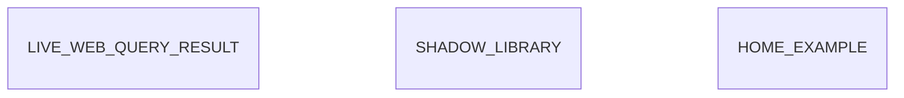

# Entity Model: Search

Finds AI resources across the catalog and live sources with one query.

## Entity Relationship Diagram

### LIVE_WEB_QUERY_RESULT

The stored answer of the metered live web search to one query, reused while fresh so that the same query does not spend another web search.

| Attribute  | Description                                                                                                                       | Data Type | Length/Precision | Validation Rules |
|------------|-----------------------------------------------------------------------------------------------------------------------------------|-----------|------------------|------------------|
| query_key  | Binary content: keyed one-way digest of the source and the normalised query, so the query text itself is not stored               | String    | -                | Primary Key      |
| fetched_at | When the web search answered; an older answer never replaces a newer one, and rows older than the retention period are deleted    | DateTime  | -                | Not Null         |
| result_ids | List of catalog resource identifiers the web search returned, in rank order; the results themselves are recorded in the catalog   | String    | -                | Not Null         |

### SHADOW_LIBRARY

A part of a host name that marks a site sharing copyrighted books and papers without permission; results on such sites are never shown.

| Attribute | Description                                                                                                            | Data Type | Length/Precision | Validation Rules |
|-----------|------------------------------------------------------------------------------------------------------------------------|-----------|------------------|------------------|
| name      | One part of a host name, 3 to 63 lower-case letters, digits and hyphens, starting and ending with a letter or a digit  | String    | -                | Primary Key      |
| added_by  | Identifier of the administrator who added the name, or "migration" for a seeded name                                   | String    | -                | Not Null         |
| added_at  | When the name was added                                                                                                | DateTime  | -                | Not Null         |
| reason    | Why the name is listed, at most 500 characters                                                                         | String    | -                | Optional         |

### HOME_EXAMPLE

An example search offered under the search box on the home page, with the catalog resources it must find near the top.

| Attribute             | Description                                                                                  | Data Type | Length/Precision | Validation Rules                         |
|-----------------------|----------------------------------------------------------------------------------------------|-----------|------------------|------------------------------------------|
| id                    | Unique identifier, chosen by the application                                                 | String    | 36               | Primary Key                              |
| label                 | Short text shown on the example, 2 to 32 characters                                          | String    | -                | Not Null                                 |
| query                 | Words the example searches, 3 to 200 characters                                              | String    | -                | Not Null                                 |
| path                  | Audience path the example searches with                                                      | String    | -                | Not Null, Values: USE_AI, BUILD_WITH_AI  |
| locale                | Language of the example, two lower-case letters, "en" by default                             | String    | -                | Not Null                                 |
| status                | Whether the example may be shown, ACTIVE by default                                          | String    | -                | Not Null, Values: ACTIVE, PAUSED         |
| expected_resource_ids | List of 1 to 3 catalog resource identifiers the example must find near the top               | String    | -                | Not Null                                 |
| origin                | How the example was made                                                                     | String    | -                | Not Null, Values: BUILT_IN, CURATED, AI_DRAFTED |
| model                 | Name of the model that drafted the example                                                   | String    | -                | Optional                                 |
| check_outcome         | Result of the last check, PENDING until checked                                              | String    | -                | Not Null, Values: PENDING, PASS, WEAK, FAIL |
| check_best_rank       | Best rank of an expected resource in the last check, 1 or more                               | Integer   | 10               | Optional                                 |
| check_result_count    | Number of results of the last check, 0 or more                                               | Integer   | 10               | Optional                                 |
| checked_at            | When the example was last checked                                                            | DateTime  | -                | Optional                                 |
| version               | Number of stored changes, used to refuse a change made on an older version                   | Integer   | 10               | Not Null                                 |
| created_at            | When the example was created                                                                 | DateTime  | -                | Not Null                                 |
| updated_at            | When the example was last changed                                                            | DateTime  | -                | Not Null                                 |

#### Constraints

- A label is unique per locale, ignoring case (locale, lower(label) are unique together).
- A query is unique per locale, ignoring case (locale, lower(query) are unique together).
- The model is present exactly when the origin is AI_DRAFTED.
