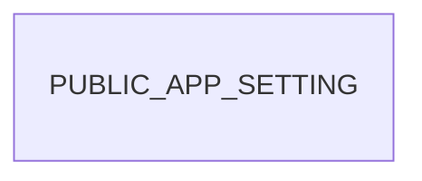

# Entity Model: Site

The public pages around search: hub pages for crawlers, the mission, privacy and terms pages, and support.

## Entity Relationship Diagram

### PUBLIC_APP_SETTING

One effective setting of the public application, published at each start so that the back office can show it; each start replaces the whole set.

| Attribute    | Description                                                                          | Data Type | Length/Precision | Validation Rules |
|--------------|--------------------------------------------------------------------------------------|-----------|------------------|------------------|
| key          | Key of the setting, starting with its group identifier; 1 to 100 characters          | String    | -                | Primary Key      |
| group_id     | Identifier of the group the setting belongs to; 1 to 50 characters                   | String    | -                | Not Null         |
| group_title  | Title of the group; 1 to 100 characters                                              | String    | -                | Not Null         |
| group_order  | Place of the group on the settings page                                              | Integer   | 10               | Not Null         |
| position     | Place of the setting within its group                                                | Integer   | 10               | Not Null         |
| label        | Name of the setting shown to the administrator; 1 to 200 characters                  | String    | -                | Not Null         |
| kind         | What kind of value the setting holds                                                 | String    | -                | Not Null, Values: COUNT, CAP, FLAG, DURATION, MODEL, VERSION, SCHEDULE, NAMES |
| value        | Value as text; empty when there is none; at most 500 characters                      | String    | -                | Optional         |
| unit         | Unit of the value; at most 50 characters                                             | String    | -                | Optional         |
| variable     | Environment variable that sets the value; at most 100 characters                    | String    | -                | Optional         |
| build        | Build of the public application that published the setting; 1 to 100 characters     | String    | -                | Not Null         |
| published_at | When the public application published its settings                                   | DateTime  | -                | Not Null         |
